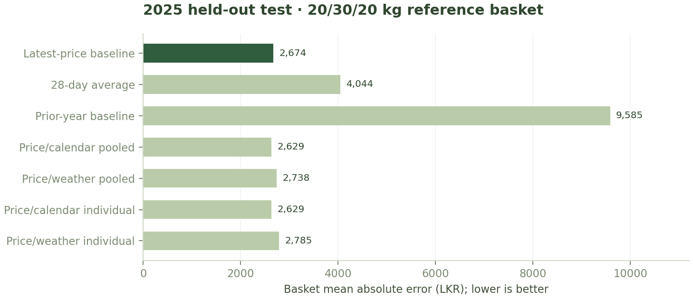
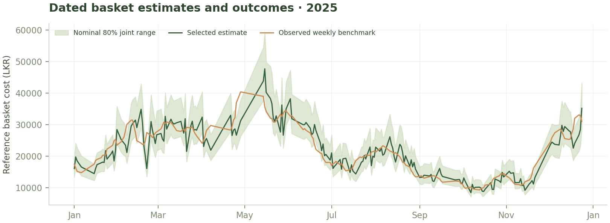
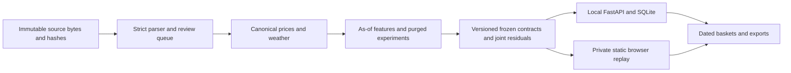

# MarketBudget — technical report

Release: `mb1.1-525ac387d5`. Generated 2026-10-26T04:07:56.077645+00:00. Status: private historical research replay.

## Result and contribution

MarketBudget is a runnable vegetable basket budgeting application for a small caterer or canteen sourcing from Dambulla. It implements a strict forecast contract, auditable data handling, chronological model experiments, a versioned API, browser interface, persistence, backup restoration and exports. The attached proposal's local research pack was not supplied; original public source files were independently recovered.

The best development candidate was **Price/weather pooled**, with **16.96%** lower development basket MAE than the strongest baseline. Its tomato MAE exceeded the 5% commodity-regression guard. The selected release method is **Latest-price baseline**. Rejection is an explicit result, not a claim that the learned model is universally inferior.

On 201 complete 2025 baskets, MAE was **LKR 2,674.05**, signed estimate-minus-outcome bias **LKR -52.11**, nominal 80% interval coverage **78.11%**, and average width **LKR 8,855.59**. No prospective buyer pilot or savings claim is made.

## Sources, preparation and audit

The vegetablesSriLanka 1.1.0 distribution contains 125,576 records. Three Dambulla wholesale series contain 6,660 rows and 157 missing values. The retained 2022+ source table has 2,958 rows, 2,926 valid quotes, and ends on 10 March 2026. All pre-2022 data were excluded because the proposal's six disputed 2021 keys were not available. The smaller training subset deliberately differs from the proposal.

Fifteen primary CBSL quotes were checked across 2023–2026, including October reference-only observations. Original 11 July 2024 package values of beans 190, carrot 68 and tomato 210 were replaced by verified wholesale Today values of 375, 345 and 190 LKR/kg. Raw PDFs, source URLs, hashes, original values and corrections are retained. Two June 2022 sample attempts returned 404; no primary 2022 quote was verified. The successful audit list and append-only failed-attempt queue are separate evidence records.

The parser locates the wholesale table, validates printed date, expected market/header order, kg units, ten aligned price cells and the Dambulla Today column. Unrecognized layouts fail closed. Current collection discovers actual links from the CBSL index and stages rows for review; it never automatically appends prices or publishes a model. A 16 October 2026 reference report is kept separate from the continuous series and is not used to imply recent coverage.

NASA POWER supplies three regional grid proxies at Nuwara Eliya (6.97,80.77), Badulla (6.99,81.06) and Kandy/Matale (7.30,80.64). Each query returned 1,591 daily rows from 1 November 2021 through 10 March 2026, with rainfall, mean/minimum/maximum temperature and humidity. These are grid proxies, not farm stations or verified district supply weights. The application credits NASA POWER.

## Forecast contract and temporal controls

At issue date d, each target is the observed-price mean over d+1 through d+7. Issue day is excluded. At least four valid observations per commodity and a fully observed seven-day calendar window are required. A basket outcome requires all three target labels. Missing labels are never interpolated or carried forward.

The central basket estimate is sum(q_i × p_i). This need not equal the basket median. Latest known prices may be carried forward only as past features, with explicit age. Features include 7/14/28-day last-known lags, observed-price means/counts, volatility, price momentum, weekday and annual cyclical terms. Weather summaries use only days ending at least seven days before issue. Unknown historical publication times, revised weather vintages and Local Solar Time mismatch remain limitations.

Training, selection, calibration and test boundaries are common across commodities. Any label extending past the end of its assigned period is purged. Weather-candidate eligibility uses only training/development availability; later complete-input exclusions are reported. No final-test outcome is used for tuning, feature selection or interval calibration. Tuning intervals are not constructed from later calibration residuals. The models remain trained on 2022–2023 after model selection; refitting on calibration or test rows is not performed.

| Split | Calendar interval | Labelled rows | Complete baskets |
| --- | --- | ---: | ---: |
| train | 2022-01-01–2023-12-31 | 1205 | 401 |
| tuning | 2024-01-01–2024-06-30 | 291 | 97 |
| calibration | 2024-07-01–2024-12-31 | 315 | 105 |
| test_2025 | 2025-01-01–2025-12-31 | 607 | 201 |
| later_2026 | 2026-01-01–2026-03-10 | 123 | 41 |

## Methods and release decision

Baselines: latest price held constant; mean of observed quotes in the trailing 28 calendar days; prior-year weekly target when available, otherwise an explicitly defined latest-price fallback. LightGBM variants cross pooled/individual commodity fits with price/calendar or price/calendar/weather features. Three quantile objectives (0.10, 0.50, 0.90) are fit for each learned variant. Target is relative change from latest price; reconstructed prices are nonnegative and quantiles sorted under a fixed crossing rule.

Fixed parameters: 180 estimators, learning rate 0.04, 9 leaves, maximum depth 4, minimum leaf sample count 30, L2 regularization 2, random seed 42, deterministic CPU fitting with two threads. This restricted configuration was not optimized against final-test results.

The strongest simple baseline and the learned candidate with lowest basket MAE are selected on Jan–Jun 2024. The learned candidate is released only if basket MAE improves at least 10% and no vegetable MAE regresses more than 5%. Otherwise the strongest baseline is retained. This policy does not search for another learned candidate after the first candidate fails a guard.

| Method | Development basket MAE (LKR) | 2025 basket MAE (LKR) |
| --- | ---: | ---: |
| Latest-price baseline | 4,559.55 | 2,674.05 |
| 28-day average | 10,036.83 | 4,043.83 |
| Prior-year baseline | 15,477.83 | 9,585.25 |
| Price/calendar pooled | 4,032.99 | 2,629.07 |
| Price/weather pooled | 3,786.14 | 2,738.32 |
| Price/calendar individual | 4,085.81 | 2,629.37 |
| Price/weather individual | 3,926.65 | 2,785.32 |

## Joint interval and evaluation

The selected method produces aligned relative residual triplets on 105 complete July–December 2024 calibration dates. For a new basket, scenario price_i=max(0, p_i×(1+residual_i)); scenario cost is the quantity-weighted sum. Keeping each triplet together preserves observed cross-commodity movement. Marginal interval endpoints are never summed. Conservative lower/upper order statistics approximate the 10th/90th percentiles, expanded to contain the central estimate. This is an empirical interval with nominal coverage, not a distribution-free or conditional-coverage guarantee.

The primary budget is 20 kg beans, 30 kg carrots and 20 kg tomatoes. Selected test commodity MAEs are beans 78.60, carrots 62.13 and tomatoes 38.26 LKR/kg. Pinball loss and raw quantile coverage for learned methods are in the machine-readable results, alongside an earlier train-2022/validate-2023 fold and early-2026 check. A shared 14-calendar-day block bootstrap of selected-minus-baseline absolute basket error returns [0,0] because the selected method is the baseline. This does not mean forecast error is zero.

Scheduled issue dates follow source-report dates, not all calendar dates. Label counts differ slightly by commodity. All candidate methods use common eligible comparison rows. Unscored dates include insufficient target observations, purged boundary windows and initial feature warm-up. Missing outcomes are never scored as correct.

| Period | Scheduled dates | Complete input dates | Withheld input dates | Evaluated baskets | Unscored dates |
| --- | ---: | ---: | ---: | ---: | ---: |
| train | 474 | 456 | 18 | 401 | 73 |
| tuning | 111 | 111 | 0 | 97 | 14 |
| calibration | 120 | 120 | 0 | 105 | 15 |
| test_2025 | 235 | 233 | 2 | 201 | 34 |
| later_2026 | 46 | 46 | 0 | 41 | 5 |

## System and delivered behavior

The browser presents a basket planner, optional budget, cost contribution, joint range, 28-day context chart, price explorer, saved baskets, evaluation and source correction trail. It uses the same frozen contract and mathematical rules as the Python API. Static-hosted saves use browser storage; local API saves use SQLite and immutable JSON contracts. Cross-language numerical tests compare varied baskets and verify exact contract-ID agreement. Backup imports validate complete saved records and merge atomically; conflicts make no changes. Comparisons are withheld on source-version mismatch. Exports include issue/target dates, replay status, source hash and model version, and guard against spreadsheet formula injection.

Fresh current mode requires today's issue-date contract and all required quotes no more than three calendar days old; stale responses contain no actionable estimate. Local API is loopback-only with no multi-user authentication. No invoice uploads, personal data collection, automated supplier orders, paid APIs or unattended jobs are configured.

Validation covers exact label windows, future feature invariance, weather buffer, boundary purges, missing labels, stale prices, malformed/zero inputs, joint residual dependence, source table/date parsing, saved-record lifecycle, outcome-unavailable behavior, exports, and browser/API parity. Browser QA exercises calculations, budget warnings, saving, comparison, restore, export, deletion and all five views at six viewport widths from 320 to 1440 px. Final verification evidence is recorded in docs/VALIDATION.md and reports/browser-qa.json.

## Limitations and next release

The package's GPL-3 declaration is retained; upstream CBSL training/redistribution permission has not been established. The private demonstration does not establish those rights. Source sampling is incomplete, especially 2022. Historical publication times and weather vintages are unavailable. Calibration has only 105 overlapping issue dates and may not transfer to new regimes. The live recent feed and prospective buyer pilot are not complete. Delivered prices vary by grade, volume, delivery and supplier terms and are not validated by this model.

Next: confirm rights, audit and append a continuous recent extension, recruit a buyer with a matching weekly purchasing workflow, freeze the prospective contract and acceptable rupee error, and run a four-to-eight-week shadow evaluation. Only then assess real decision value and a hosted operational release. Source failure must withhold fresh forecasts, not silently relabel a historical result as live.

## Sources and credits

1. vegetablesSriLanka 1.1.0, Talagala, Jayarathne and Talagala: https://thiyangtdata.r-universe.dev/vegetablesSriLanka (package GPL-3).
2. CBSL Daily Price Report: https://www.cbsl.gov.lk/en/statistics/economic-indicators/price-report (original PDFs and SHA-256 manifests retained).
3. NASA POWER daily API: https://power.larc.nasa.gov/docs/services/api/temporal/daily/ and data FAQ: https://power.larc.nasa.gov/docs/faqs/data/ .
4. LightGBM: https://lightgbm.readthedocs.io/ ; pandas: https://pandas.pydata.org/ ; FastAPI: https://fastapi.tiangolo.com/ .
5. DM Sans font authors, SIL Open Font License. Third-party libraries retain their own terms. New project code: GPL-3.0-or-later.

AI disclosure: OpenAI Codex assisted in source recovery, implementation, experimentation, tests and documentation. No interviews, pilot results, source observations or accuracy metrics were invented. Submission ownership and final review remain with the original team.

## Application 1.2 implementation addendum

Approved datasets and forecast bundles are immutable and hash-verified. Collection stages candidates; training writes isolated runs. The builder validates a complete staged site before replacement. Decimal business arithmetic, strict shared record validation, transactional IndexedDB saves, explicit runtime storage, legacy recovery and accessible chart inspection are implemented.

A separate six-fold study of 20 fixed candidates found a best observed 6.60% development gain. Selected nominal-80% development coverage was 71.67%. Research promotion remains disabled. See the standalone research report for guard decisions and uncertainty.

See REVIEW.md, VALIDATION.md and RESEARCH_REPORT.md for implementation evidence, regression tests and the separate study.
